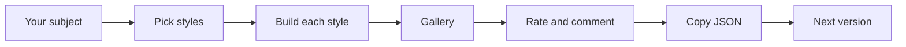

<p align="center"></p>

# Lookbook

**One screen, every style.** A Claude Code skill that builds the same screen in several design styles and puts them side by side in one gallery you can rate.

## What it does
- Asks which styles to compare from a catalog of 22, marking its recommendations for your subject with ⭐.
- Builds every style from one shared content spec, so only the look changes.
- Opens a gallery: side by side, at desktop or phone width, any style full screen.
- You rate each style 1–5 and comment. The page assembles it into JSON with one **Copy feedback** button for any AI.
- Keeps body text readable (WCAG AA) in every style, including the soft ones.

## How it works


## Install
`SKILL.md` follows the open [Agent Skills](https://agentskills.io/specification) format. Keep `styles.md` and `gallery_template.html` next to it.

**Claude Code:**
```bash
git clone https://github.com/JR91387/lookbook-ai-ux-gallery-skill ~/.claude/skills/lookbook
```

**Other agents that support Agent Skills:** clone into that agent's skills folder.

## Usage
```
/lookbook a pricing page for a bike repair shop
```
Paste the copied JSON back into the chat to get the next version built from your ratings.

## Styles
Claymorphism · Cybercore · Neo-Brutalism · Scrapbook · Surrealism · Y2K Aesthetic · Pixel Art · Synthwave · Glassmorphism · Neumorphism · Bento Grid · Editorial Design · Swiss Design · Minimalism · Maximalism · Luxury Typography · Conceptual Sketch · Ethereal · Bohemian · Victorian · Cyberpunk · Wabi-Sabi

Each style in `styles.md` has a definition, a feel, a well-known example to look up, and a one-line build cue.

## Files
| File | What it is |
|---|---|
| `SKILL.md` | The skill: steps, style picking, feedback JSON format |
| `styles.md` | The 22-style catalog |
| `gallery_template.html` | The rating gallery every lookbook is built from; one self-contained file, nothing loaded from the web |

## Credits
Style reference previews: [chrislemke/website_designs](https://github.com/chrislemke/website_designs) (MIT), linked by name only. Built with AI assistance (Claude).

## License
[MIT](LICENSE)

---

Built by **Jerry Reinitz** · [github.com/JR91387](https://github.com/JR91387) · [jerryreinitz.com](https://jerryreinitz.com)<br>
Midwest AI and software engineer who builds for people, not for checkboxes.

---

**More from Reinitz Industries:** [Word Vomit Jargon](https://github.com/JR91387/vomit-jargon-ai-skill) · [/bruh](https://github.com/JR91387/claude-skill-bruh) · [/bully](https://github.com/JR91387/claude-skill-bully) · [Job-o-Matic](https://github.com/JR91387/jobomatic-reusme-skills-database) · [Preen](https://github.com/JR91387/Preen-AI-email-sorting) · [Calendar Forge](https://github.com/JR91387/calendar-forge-ics)
