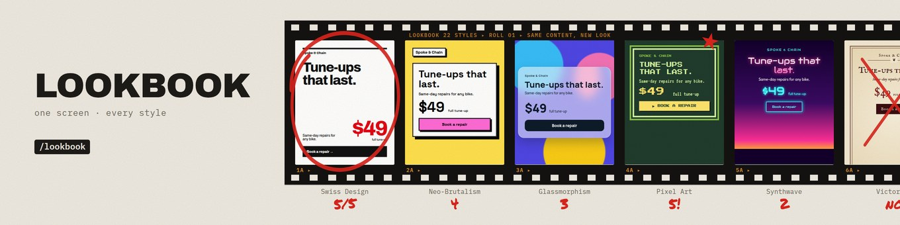
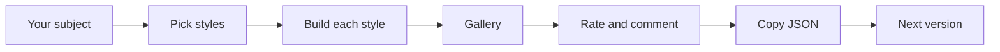

<p align="center"></p>

# Lookbook

**One screen, every style.** A Claude Code skill that builds the same screen in several design styles and puts them side by side in one gallery you can rate.

## What it does
- Asks which styles to compare from a catalog of 22 (18 more on request), marking its recommendations for your subject with ⭐.
- Builds from your project's own logos, screenshots, theme files, docs and notes, so the mockups look like your product, not a template.
- Builds every style from one shared content spec, so only the look changes.
- Opens a gallery: side by side, at desktop or phone width, any style full screen.
- You rate each style 1–5 and comment. The page assembles it into JSON with one **Copy feedback** button for any AI.
- Keeps body text readable (WCAG AA) in every style, including the soft ones.

## The 22 styles
Grouped the way the picker asks. Each one in [`styles.md`](styles.md) has a definition, a feel, a well-known example to look up, and a build cue.

| Group | Styles | Feel |
|---|---|---|
| **Soft / 3D** | Glassmorphism · Neumorphism · Claymorphism · Ethereal | Airy, tactile, calm |
| **Retro** | Y2K Aesthetic · Pixel Art · Synthwave · Cybercore | Nostalgic, shiny, neon |
| **Bold / raw** | Neo-Brutalism · Maximalism · Scrapbook · Surrealism | Loud, personal, surprising |
| **Structured** | Swiss Design · Minimalism · Bento Grid · Editorial Design | Rational, quiet, scannable |
| **Ornate** | Luxury Typography · Victorian · Bohemian · Wabi-Sabi | Rich, crafted, grounded |
| **Wildcards** | Cyberpunk · Conceptual Sketch | Edgy, or deliberately unfinished |

### Want more?
The picker stays at 22 so choosing is quick. [chrislemke/website_designs](https://github.com/chrislemke/website_designs) catalogs 314 styles ([browse the previews](https://chrislemke.github.io/website_designs/)); type any of them into "Other". A shortlist of common gaps, also in `styles.md`:

| Group | Styles |
|---|---|
| Modernist classics | [Bauhaus](https://chrislemke.github.io/website_designs/examples/Bauhaus.html) · [Art Deco](https://chrislemke.github.io/website_designs/examples/Art_Deco.html) · [Mid-Century Modern](https://chrislemke.github.io/website_designs/examples/Mid-Century_Modern.html) · [Memphis Design](https://chrislemke.github.io/website_designs/examples/Memphis_Design.html) |
| Digital eras | [Flat Design](https://chrislemke.github.io/website_designs/examples/Flat_Design.html) · [Material Design](https://chrislemke.github.io/website_designs/examples/Material_Design.html) · [Skeuomorphism](https://chrislemke.github.io/website_designs/examples/Skeuomorphism.html) · [Frutiger Aero](https://chrislemke.github.io/website_designs/examples/Frutiger_Aero.html) · [Windows 95/98](https://chrislemke.github.io/website_designs/examples/Windows_95_98.html) · [Vaporwave](https://chrislemke.github.io/website_designs/examples/Vaporwave.html) |
| Product and tech | [Terminal / CLI](https://chrislemke.github.io/website_designs/examples/Terminal_CLI_Aesthetic.html) · [Dark Mode Neon](https://chrislemke.github.io/website_designs/examples/Dark_Mode_Neon.html) · [Liquid Glass](https://chrislemke.github.io/website_designs/examples/Liquid_Glass.html) · [Isometric Design](https://chrislemke.github.io/website_designs/examples/Isometric_Design.html) |
| Mood | [Japandi](https://chrislemke.github.io/website_designs/examples/Japandi.html) · [Dark Academia](https://chrislemke.github.io/website_designs/examples/Dark_Academia.html) · [Solarpunk](https://chrislemke.github.io/website_designs/examples/Solarpunk.html) · [Risograph](https://chrislemke.github.io/website_designs/examples/Risograph.html) |

## How it works


## Install
`SKILL.md` follows the open [Agent Skills](https://agentskills.io/specification) format. Keep `styles.md` and `gallery_template.html` next to it.

**Claude Code:**
```bash
git clone https://github.com/JR91387/lookbook-ai-ux-gallery-skill ~/.claude/skills/lookbook
```

**Other agents that support Agent Skills:** clone into that agent's skills folder.

## Usage
```
/lookbook a pricing page for a bike repair shop
```
Paste the copied JSON back into the chat to get the next version built from your ratings.

## Files
| File | What it is |
|---|---|
| `SKILL.md` | The skill: steps, style picking, feedback JSON format |
| `styles.md` | The 22-style catalog, plus an 18-style shortlist from the wider catalog |
| `gallery_template.html` | The rating gallery every lookbook is built from; one self-contained file, nothing loaded from the web |

## Credits
Style reference previews and the wider catalog: [chrislemke/website_designs](https://github.com/chrislemke/website_designs) (MIT), linked, not copied. Built with AI assistance (Claude).

## License
[MIT](LICENSE)

---

Built by **Jerry Reinitz** · [github.com/JR91387](https://github.com/JR91387) · [jerryreinitz.com](https://jerryreinitz.com)<br>
Midwest AI and software engineer who builds for people, not for checkboxes.

---

**More from Reinitz Industries:** [Word Vomit Jargon](https://github.com/JR91387/vomit-jargon-ai-skill) · [/bruh](https://github.com/JR91387/claude-skill-bruh) · [/bully](https://github.com/JR91387/claude-skill-bully) · [Job-o-Matic](https://github.com/JR91387/jobomatic-reusme-skills-database) · [Preen](https://github.com/JR91387/Preen-AI-email-sorting) · [Calendar Forge](https://github.com/JR91387/calendar-forge-ics)
